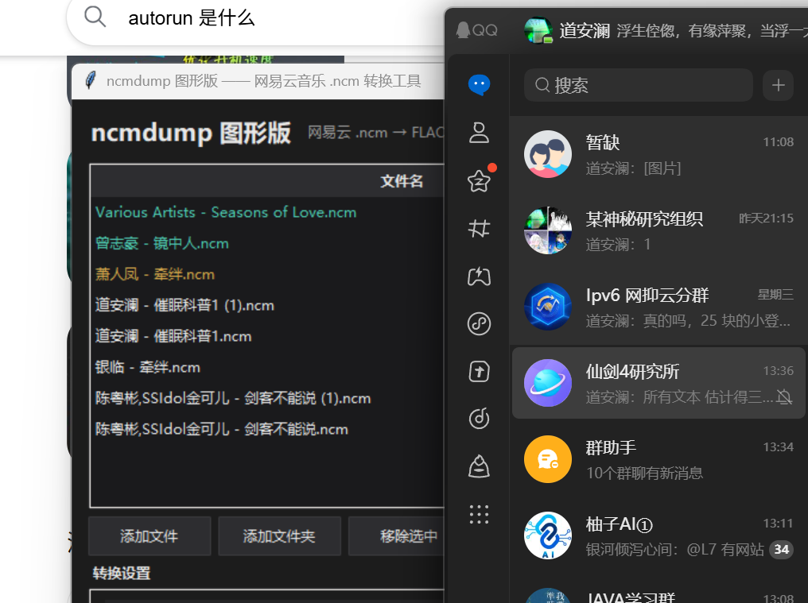

# ncmdump

> **这是 [taurusxin/ncmdump](https://github.com/taurusxin/ncmdump) 的 Fork。**
> 原版的命令行 C++ 程序完整保留（用法见下方原文）。本 Fork 在此之上增加了一个
> **Windows 图形界面版**：拖进去就能把 `.ncm` 单个或批量转换成 FLAC / MP3。



## 图形界面版（本 Fork 新增）

### 下载

到本仓库的 [Releases](../../releases) 页面下载，解压后双击 `ncmdump-gui.exe` 即可，
**不需要安装 Python 或 ffmpeg**——静态版 ffmpeg 已经内置在程序里。

提供两种形式：

| 文件 | 体积 | 特点 |
| --- | --- | --- |
| `ncmdump-gui.exe` | 约 43 MB | 单个 exe，拷到哪都能用；每次启动需解包到临时目录，约慢几秒 |
| `ncmdump-gui-portable.zip` | 约 70 MB | 目录版，解压即用，启动更快（推荐） |

### 用法

1. 把 `.ncm` 文件**拖进**窗口中间的列表，或用「添加文件 / 添加文件夹」按钮。
   添加文件夹会递归扫描子目录，适合一次处理整个下载目录。
2. 选输出格式：**FLAC（无损）** / **MP3** / **与源文件相同**。
3. 需要的话指定输出目录，留空则输出在源文件旁边。
4. 点「开始转换」。

### 功能

| 项目 | 说明 |
| --- | --- |
| 输出格式 | FLAC / MP3 / 与源文件相同 |
| MP3 码率 | 320 / 256 / 192 / 128 kbps |
| FLAC 压缩级别 | 0–11（默认 5，只影响体积，不影响音质） |
| 批量 | 多文件 + 文件夹递归，并行数 1–8 可调 |
| 文件命名 | 「标题 - 艺术家」或沿用原文件名 |
| 元数据 | 自动写回标题、艺术家、专辑、封面图 |
| 歌词 | 同目录有同名 `.lrc` 时自动嵌入 |
| 重名 | 默认跳过已存在文件，可勾选覆盖 |

### 关于音质，有一件事要说清楚

输出格式与源文件相同时**直接提取、不重编码**，音质零损失。

反过来，源文件是 MP3 时选 FLAC，只是把有损音频装进无损容器——文件涨到三四倍，
音质一点没变好。这种情况请选「与源文件相同」。

### 和原版 C++ 程序的关系

图形界面版**没有编译原版 C++**（那需要 vcpkg + taglib），而是把
`src/ncmcrypt.cpp` 的解密算法逐行移植成了纯 Python：

- AES-128-ECB 自行实现（S-box 由 GF(2⁸) 生成），不引入第三方加密库；
- keybox 流密钥周期为 256 字节，预展开后整块 XOR，100 MB 的文件解密只需一两秒；
- 元数据解析、封面提取、格式判定（ID3 头 → MP3，否则 FLAC）与原版一致。

转码用内置 ffmpeg，标签写入用 [mutagen](https://github.com/quodlibet/mutagen)。
实测解密结果与 ffprobe 校验的时长、码率、容器格式均与文件内嵌元数据吻合。

### 目录结构

```
gui/
  ncmcore.py     解密核心：AES-128-ECB + RC4-like keybox，元数据与封面解析
  transcoder.py  ffmpeg 转码调用 + mutagen 写标签（含封面尺寸解析）
  converter.py   单文件转换流程编排
  gui.py         tkinter 图形界面（深色主题，支持拖拽）
  app.py         程序入口
  build.py       打包脚本
  make_icon.py   生成图标
```

### 自己打包

```bash
pip install pyinstaller mutagen imageio-ffmpeg tkinterdnd2
cd gui
python build.py              # 目录版
python build.py --onefile    # 单 exe 版
```

打包脚本会自动找一个**单文件静态版** ffmpeg（优先使用 `imageio-ffmpeg` 自带的）
一起打进去。想换成自己的 ffmpeg，把 `ffmpeg.exe` 放到程序所在目录即可，程序会优先用它。

### 说明

- 只处理 `.ncm` 容器本身，不涉及任何授权判断——转换的是你已经下载到本地的文件。
- 解密完全在本机进行，不联网。
- 图形界面部分与上游同样按 MIT 发布，算法版权归 taurusxin/ncmdump 及其前辈作者。

### 关于 ffmpeg 的许可证（请注意）

仓库里的源码是 MIT，但**发布的二进制包内置了 ffmpeg**，而该 ffmpeg 是
[GPL 授权的静态构建](https://ffmpeg.org/legal.html)（来自 imageio-ffmpeg / BtbN FFmpeg-Builds）。
因此：

- 分发出去的**二进制包**整体受 GPL 约束，需要提供 ffmpeg 的源码或书面索取方式；
- 如果你希望分发物保持纯 MIT，把程序目录里的 `ffmpeg.exe` 换成一个 LGPL 构建即可
  —— 程序会优先使用外部放置的 ffmpeg，而不是内置的。

---

# ncmdump（上游原版 README）

以下内容为原版 README，未作改动。


使用本程序可将下载的网易云音乐缓存文件（ncm）转换为 mp3 或 flac 格式

## 简介

该版本为最早的 C++ 版本，也是作者开发的市面上第一个支持 ncm 转换的程序

源码复刻自 anonymous5l/ncmdump (2021年10月6日，原作者已经删库)

感谢前辈的付出！此版本做了全操作系统下的的跨平台编译移植，修复了一些内存溢出的问题。

1.3.0 版本更新说明：因为之前有较多 Issue 反馈无法解密带有特殊字符的文件名，例如中文、日文、韩文或者是表情符号等，在1.3.0以及之后的版本彻底修复了这个问题，所有的 UTF-8 字符都可以正常解密。并且还自带了 dll 的构建，可以供其他应用程序（C#、Python、Java等）调用。

## 使用

注意：网易云音乐 3.0 之后的某些版本，下载的 ncm 文件会出现不内置歌曲专辑的封面图片的情况，所需的封面图数据需要从网络获取，介于在一个小工具中嵌入庞大网络库的非必要性，可以移步我的另一个仓库 [ncmdump-go](https://git.taurusxin.com/taurusxin/ncmdump-go) 或者使用基于此项目开发的可视化 GUI 程序 [ncmdump-gui](https://git.taurusxin.com/taurusxin/ncmdump-gui)，其中后者基于前者，均完全使用 Golang 重写，并支持自动从元数据读取封面信息后从网络获取封面图并嵌入到目标音乐文件。

### 命令行工具

从 [Release](https://github.com/taurusxin/ncmdump/releases) 下载最新版本的对应系统的已编译好的二进制文件

使用 `-h` 或 `--help` 参数来打印帮助

```shell
ncmdump -h
```

使用 `-v` 或 `--version` 参数来打印版本信息

```shell
ncmdump -v
```

处理单个或多个文件

```shell
ncmdump 1.ncm 2.ncm...
```

使用 `-d` 参数来指定一个文件夹，对文件夹下的所有以 ncm 为扩展名的文件进行批量处理

```shell
ncmdump -d source_dir
```

使用 `-r` 配合 `-d` 参数来递归处理文件夹下的所有以 ncm 为扩展名的文件

```shell
ncmdump -d source_dir -r
```

使用 `-m` 参数来删除源文件若正确处理

```shell
ncmdump -m
```

使用 `-o` 参数来指定输出目录，将转换后的文件输出到指定目录，该参数支持与 `-r` 参数一起使用

```shell
# 处理单个或多个文件并输出到指定目录
ncmdump 1.ncm 2.ncm -o output_dir

# 处理文件夹下的所有以 ncm 为扩展名并输出到指定目录，不包含子文件夹
ncmdump -d source_dir -o output_dir

# 递归处理文件夹并输出到指定目录，并保留目录结构
ncmdump -d source_dir -o output_dir -r
```

### 动态库

或者，如果你想利用此项目进行二次开发，例如在你的 C#、Python、Java 等项目中调用，你可以使用 `libncmdump` 动态库，具体使用方法见仓库的 `example` 文件夹

请注意！如果你在 Windows 下开发，传递到库构造函数的文件名编码**必须为 UTF-8 编码**，否则会抛出运行时错误。

## 编译项目

克隆本仓库

```shell
git clone https://github.com/taurusxin/ncmdump.git
```

### Windows

安装 Visual Studio 2022 和 cmake，并安装 C++ 桌面开发环境，然后安装 [vcpkg](https://github.com/microsoft/vcpkg)

```shell
# 安装 vcpkg 并安装 taglib 的静态库
git clone https://github.com/microsoft/vcpkg.git
cd vcpkg
./bootstrap-vcpkg.bat
```

配置项目

```shell
# 使用 cmake 配置项目，替换 %VCPKG_ROOT% 为你的 vcpkg 安装路径
cmake -G "Visual Studio 17 2022" -DCMAKE_TOOLCHAIN_FILE=%VCPKG_ROOT%/scripts/buildsystems/vcpkg.cmake -DVCPKG_TARGET_TRIPLET=x64-windows-static -B build

# 编译项目
cmake --build build -j 8 --config Release
```

### macOS

macOS 下，你可以方便地使用 Homebrew 来安装 taglib 库

```shell
# 安装 taglib 库
brew install taglib

# 配置项目
cmake -DCMAKE_BUILD_TYPE=Release -B build

# 编译项目
cmake --build build -j$(nproc)
```

### Linux

Linux 下，由于 Ubuntu 24.04 的 taglib 仍然为 1.x 版本，不支持 CMake，所以需要手动编译安装 2.x 版本，目前 GitHub Actions 的 Linux 构建流程也是手动编译。

```shell
# 拉取源码
wget https://github.com/taglib/taglib/releases/download/v2.1.1/taglib-2.1.1.tar.gz

# 解压并进入
tar -xzf taglib-2.1.1.tar.gz && cd taglib-2.1.1

# 配置、编译和安装
cmake -DCMAKE_INSTALL_PREFIX=/usr/local -DCMAKE_BUILD_TYPE=Release .
make -j$(nproc)
sudo make install
```

然后和 macOS 上一样，使用 CMake 配置项目并编译项目

```shell
# 配置项目
cmake -DCMAKE_BUILD_TYPE=Release -B build

# 编译项目
cmake --build build -j$(nproc)
```

---

你可以在 `build` 文件夹下找到编译好的二进制文件，以及一个可供其它项目使用的动态库(Windows Only)，使用方法见仓库的 `example` 文件夹

